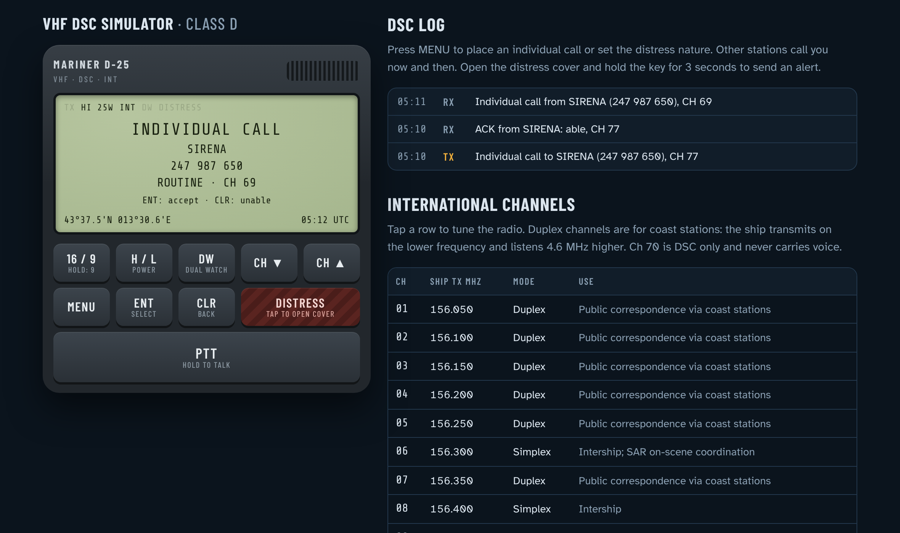

# vhf-dsc-sim

Class D VHF/DSC radio sim. Open `index.html`.

- channels, 16/9, H/L, DW, PTT
- DSC: individual calls, incoming calls, log
- distress key (cover, hold 3s), ack, cancel
- no voice yet

MENU / CH▲▼ / ENT / CLR.

Not a real radio. Names and MMSIs are fake.

(c) Michele D'Incecco, all rights reserved. See LICENSE.
